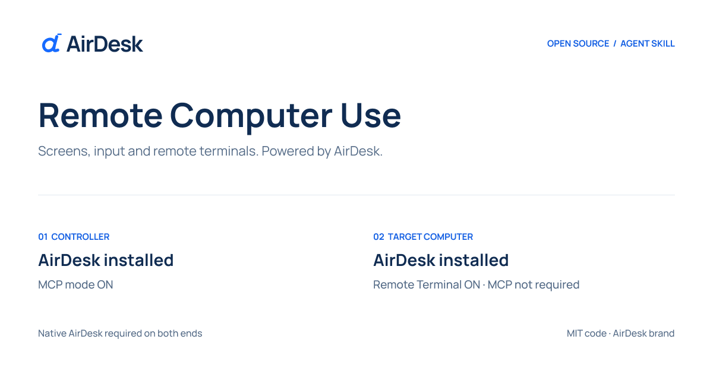

<p align="center">
  
</p>

# AirDesk Remote Computer Use

[English](README.md) · [설치 안내](skills/remote-computer-use/references/setup.md) · [보안](SECURITY.md) · [검증 범위](docs/validation.md)

AirDesk의 네이티브 MCP 서버를 통해 허가된 원격 컴퓨터의 화면을 확인하고,
마우스·키보드·원격 터미널 및 지원되는 Windows 데스크톱 자동화를 사용하는
오픈소스 **Agent Skill**입니다.

> **제어하는 컴퓨터와 대상 컴퓨터 모두 AirDesk가 설치되어 있어야 하며,
> MCP 모드는 클라이언트에서만 ON이면 됩니다.**
> 클라이언트는 MCP 모드만 켜면 됩니다. 원격 터미널 허용은 대상 PC에서만 필요합니다.
> 대상 호스트의 MCP 모드는 꺼져 있어도 됩니다. 호스트 원격 터미널이 OFF이면
> AI가 켜 달라고 요청한 뒤 터미널·창 자동화를 진행합니다. 호스트 실행·공유·접근 승인도
> 필요합니다. 이 조건을 충족하지 않으면 사용할 수 없습니다.
> 이 저장소만으로 원격 제어 서버가 설치되거나 실행되지는 않습니다.

## 구성

- 동의 확인, 좌표 변환, 결과 검증, 정리 절차를 포함한 [스킬](skills/remote-computer-use/SKILL.md)
- 외부 Python 패키지 없이 동작하는 로컬 진단·MCP 설정 출력 도구
- 스킬 설치·네이티브 MCP 등록·클라이언트 MCP 모드 활성화를 수행하는 npm 설치기
- 설치 문서, 보안 지침, 회귀 테스트와 CI
- 기존 AirDesk 로고 및 Figma로 제작한 저장소 표지

## 시작하기

양쪽 PC에 [AirDesk](https://airdesk.co.kr)를 설치한 뒤,
**AI에게 이 GitHub 주소를 설치해 달라고 요청하세요.**

> https://github.com/AirDesk-Inc/remote-coumputer-use.git 를 설치해줘.
> 이 PC의 AirDesk MCP 모드를 켜고 네이티브 MCP 서버도 등록해줘.
> 클라이언트의 원격 터미널 허용은 변경하지 말아줘.

설치기는 `~/.agents/skills/`에 스킬을 설치하고, 기존 Codex 설정을 유지하면서
네이티브 MCP 서버를 등록합니다. MCP 활성화는 설치 시 한 번만 수행합니다.
AirDesk에서 로그인하고 MCP 클라이언트를 다시 로드하세요. 대상 PC에서는
소유자가 원격 터미널·호스트 접근 권한을 확인하면 됩니다. 대상의 MCP는 필요 없습니다.

### npm / npx 설치

설치기는 Node.js 22 이상이 필요합니다. 패키지는 **npm 배포 준비 상태이며 아직
게시되지 않았습니다.** 최초 게시 후에는 다음 명령으로 설치할 수 있습니다.

```sh
npx @airdesk/remote-computer-use install
```

현재는 GitHub 저장소를 받은 폴더에서 실행합니다.

```sh
npm ci --ignore-scripts
node bin/cli.mjs install
```

Windows 또는 별도 설치 경로에서는 `--binary`로 신뢰하는 AirDesk 실행 파일의
절대 경로를 지정합니다. `--dry-run`은 실행·저장 없이 계획만 확인하고,
`--skip-mcp`는 스킬만 설치합니다. 기존 스킬이나 MCP 설정이 다르면 덮어쓰지 않습니다.
자동 활성화는 `--mcp-server --mcp-setup`을 지원하는 AirDesk 빌드가 필요합니다.
구버전은 업데이트하거나 수동 설정을 사용하세요.
[설치 안내](skills/remote-computer-use/references/setup.md)와
[npm 배포 준비](docs/npm-release.md)를 참고하세요. 계정 토큰을 설정에 적거나
MCP를 공개 네트워크에 노출하지 마세요.

사용 예시:

> $remote-computer-use로 허가된 사무실 PC의 화면을 확인해줘.
> 양쪽 모두 AirDesk가 설치되어 있고 클라이언트 MCP가 켜져 있어.
> 대상 PC의 원격 터미널이 꺼져 있으면 켜 달라고 알려줘.
> 접근 권한도 승인했어. 이름이 중복되면 대상 PC를 먼저 물어봐.

실제 확인한 조건만 전달하세요. MCP 활성화는 모든 명령의 실행 동의가 아니며,
클라이언트의 도구 승인 절차도 유지해야 합니다.

## 로컬 진단

선택 사항인 진단 도구만 Python 3.10 이상이 필요합니다. 스킬과 AirDesk 네이티브
MCP 연결 자체에는 Python이 필요하지 않습니다.

```sh
python3 skills/remote-computer-use/scripts/airdesk_mcp.py doctor
python3 skills/remote-computer-use/scripts/airdesk_mcp.py config --client codex
```

Windows나 별도 설치 경로에서는 `--binary`로 신뢰할 수 있는 AirDesk 실행 파일의
절대 경로를 지정합니다. `doctor`는 자기 컴퓨터에서 MCP 초기화, 도구 목록 조회,
`remote_status` 확인만 수행합니다. 원격 연결·화면 캡처·입력·명령 실행·설정 변경은
하지 않습니다. `config`도 설정 내용을 출력할 뿐 파일을 수정하지 않습니다.

**로컬 진단 성공이 대상 PC의 접근 권한 확인을 의미하지는 않습니다.**
`remote_status`의 MCP 설정값은 제어 PC 기준입니다. 대상의 공유·접근 권한은
별도로 확인합니다. 대상 원격 터미널이 OFF이면 AI가 켜 달라고 요청하며,
대상 PC의 MCP 활성화는 요구하지 않습니다.

## 지원 범위

| 기능 | 조건 |
| --- | --- |
| 컴퓨터 조회·접속 | AirDesk 인증 및 대상 PC 접근 승인, MCP 프로세스당 한 대상 |
| 화면 캡처·디스플레이 선택 | 최신 화면 크기 확인 및 원본 픽셀 좌표 변환 |
| 마우스·키보드·텍스트 | 입력 준비 상태 확인 후 동작 결과 검증 |
| 원격 터미널 | 호환되는 Windows/macOS 대상과 터미널 권한 |
| 앱·창·UI 요소 자동화 | 지원되는 Windows 대상만 해당 |
| macOS UI Automation·모바일 MCP·독립 Linux 호스팅 | 이 프로젝트가 제공하거나 보장하는 기능 아님 |

실제 지원은 설치된 AirDesk 버전, 대상 플랫폼, 권한과 도구 목록에 따라 다릅니다.
현재 검증 내용과 실원격 테스트의 한계는 [검증 문서](docs/validation.md)에 구분했습니다.

AI는 네이티브 `terminal_open`·`terminal_write`·`terminal_read`로 대상 PC의
터미널을 사용합니다. Windows에서는 `remote_list_windows`·`remote_get_window`로
검증된 창 ID, 제목, 프로세스 ID, 위치·크기 및 상태를 조회합니다.
임의의 숫자 핸들을 추측하지 않고, 서버가 반환한 창 ID로 조작합니다.

## 개발과 라이선스

```sh
npm ci --ignore-scripts
npm test
npm run check:package
python3 -m unittest discover -s tests -v
```

테스트는 로컬 모의 서버만 사용하며 실제 원격 PC나 계정에 접속하지 않습니다.
CI는 macOS·Windows·Linux에서 진단 도구를 검증합니다.

새로 작성한 스킬·스크립트·문서·테스트는 **[MIT](LICENSE)**입니다.
AirDesk 앱 본체에는 적용되지 않습니다. 로고·상표·브랜드 이미지는 MIT에서 제외되며
[별도 브랜드 조건](TRADEMARKS.md)을 따릅니다.

저장소 주소의 `remote-coumputer-use`는 요청된 이름을 유지한 것이며,
설치되는 스킬의 이름은 `remote-computer-use`입니다.
