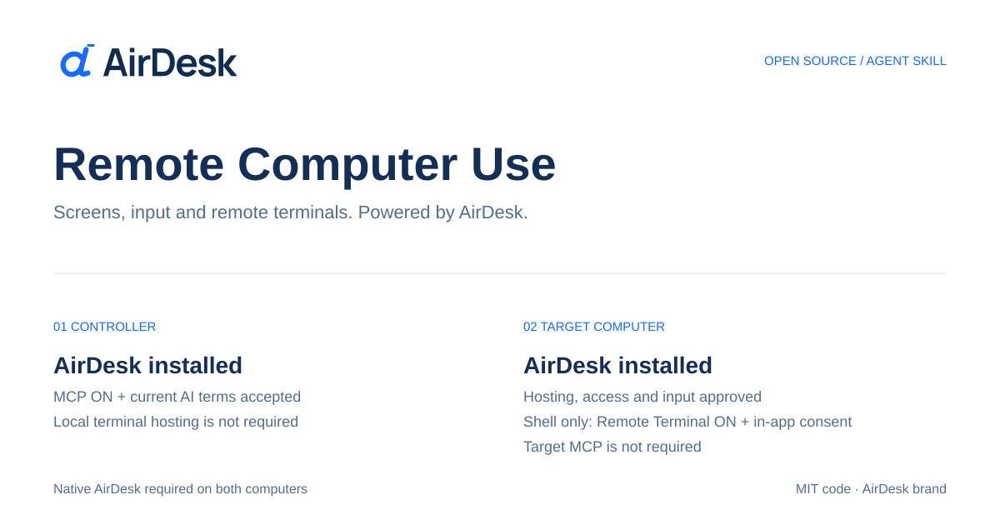

<p align="center">
  
</p>

# AirDesk Remote Computer Use

[한국어](README.ko.md) · [Setup](skills/remote-computer-use/references/setup.md) · [Security](SECURITY.md) · [Validation](docs/validation.md)

An open-source **Agent Skill** for operating authorized remote computers through
AirDesk's native MCP server: screenshots, mouse and keyboard input, remote
terminals, Windows/macOS desktop automation, and Chromium browser DOM control.

> **Install AirDesk on both computers. MCP mode is required only on the controller.**
> The controller needs MCP mode only, not local terminal hosting. Enable Remote
> Terminal on the target for shell commands only; target MCP can stay OFF.
> Desktop/browser automation uses approved host access and input permissions.
> If target Remote Terminal is OFF, the AI asks you to enable it before shell work.
> The target must be running, shared,
> and approved for the intended user. Without these prerequisites, do not use
> the skill. This repository is not a standalone remote access application.

## What's Included

- A portable [Agent Skill](skills/remote-computer-use/SKILL.md), with explicit
  consent, coordinate mapping, verification, and cleanup instructions.
- A dependency-free Python setup helper that prints MCP configuration or checks
  **local** prerequisites without connecting to a target.
- An npm installer that installs the skill, registers the native MCP server,
  and enables only the controller's MCP mode through AirDesk itself.
- English/Korean documentation, security guidance, regression tests, and CI.
- Existing AirDesk identity assets and a Figma-authored repository cover.

## Quick Start

Install [AirDesk](https://airdesk.co.kr) on both computers. On the controller,
sign in and review/accept the AI remote-access terms when enabling MCP in the
app. Then ask your AI agent to install this GitHub repository:

> Install https://github.com/AirDesk-Inc/remote-coumputer-use.git.
> Enable this computer's AirDesk MCP mode and register its native MCP server.
> Leave this computer's Remote Terminal hosting setting unchanged.

The installer copies the skill to `~/.agents/skills/` and adds an `airdesk` server
to Codex configuration by default, preserving unrelated settings. JSON client
support is selected explicitly with `--client` and the actual `--config` path.
It enables MCP once during installation, not on every server startup; terms are
never accepted automatically. Reload your MCP client. The target owner enables host access and Remote Terminal for
shell terminal tools; no target MCP activation is needed for automation.

### npm / npx

Node.js 22+ is required for the installer:

```sh
npx @airdesk/remote-computer-use install
```

Alternatively, from a checkout of the repository:

```sh
npm ci --ignore-scripts
node bin/cli.mjs install
```

Use `--binary` with the trusted AirDesk executable's absolute path on Windows or
nonstandard installs. `--dry-run` previews without executing AirDesk or writing
files; `--skip-mcp` installs only the skill. Conflicting skills/configuration are
not overwritten. An unchanged official 0.1.0/0.1.1 skill can be explicitly upgraded
with `--upgrade`; its full previous directory is retained as a backup. Use
`--upgrade --skip-mcp` for a skill-only update. Automatic setup requires an AirDesk build supporting
`--mcp-server --mcp-setup` and current consent metadata. Older builds must be
updated; manual configuration cannot establish missing consent status.
See [full setup](skills/remote-computer-use/references/setup.md) and
[npm release guide](docs/npm-release.md). Never add account tokens to MCP
configuration or expose the server publicly.

Ask your agent, for example:

> Use $remote-computer-use to inspect the display on my authorized office PC.
> Both computers have AirDesk; controller MCP is ON with current AI terms accepted,
> and I have approved target access. Ask me to select ambiguous targets.
> If shell work is needed and target Remote Terminal is OFF, ask me to enable it and wait for confirmation.

That example describes required confirmation; do not assert it unless it is true.
Keep your client's tool approval controls enabled.

You can shorten the skill name to `rcu` or `RCU` in conversation:

> Use rcu with AirDesk to inspect the display on my authorized office PC.

This is a conversational shorthand. Explicit skill invocation remains
`$remote-computer-use`; package, executable and MCP tool names are unchanged.
The same setup and approval requirements apply to this shorthand.

MCP/RCU remote-desktop connections must open a **real interactive remote window
on the controller**, not an observation-only window. The default policy and the
skill explicitly use `video:true,showWindow:true`, with local mouse/keyboard
forwarding and the normal toolbar, subject to existing host input permissions.
Manual and AI input share the window: pause AI input during user interaction,
then re-observe after handback before resuming. Native MCP/agent ownership,
session IDs and cleanup remain in force. Closing the real window ends its owned
MCP session and initiates owned-terminal/held-input cleanup; do not silently reconnect.

Clipboard is independent and remains disabled for MCP ownership, including
automatic capture/sync. Opening the window does not enable audio; microphone,
overlay and recording settings are unchanged. Do not expect automatic clipboard
or audio. Headless (`video:true,showWindow:false`) and no-video (`video:false`,
which also disables the window) modes require the user's explicit request.
If the native schema lacks `showWindow` or the build only opens an observation-only
window, stop desktop input and request a compatible app update instead of silently
falling back. Installing the skill alone does not update the native app or prove
interactive behavior. See [connection modes](skills/remote-computer-use/references/screen-control.md#session-window).

## Optional Local Check

Python 3.10+ is only required for this helper, not the native MCP connection:

```sh
python3 skills/remote-computer-use/scripts/airdesk_mcp.py doctor
python3 skills/remote-computer-use/scripts/airdesk_mcp.py config --client codex
```

On Windows/nonstandard installs, pass `--binary` with the trusted executable's
absolute path. The helper never installs apps, enables settings, modifies client
configuration, or performs a remote action.

**A successful local check does not verify target access.** `remote_status`
reports the controller's MCP settings, not target permission approval. Verify
host sharing/access separately. If Remote Terminal is OFF on the target, the
agent asks you to turn it ON only for shell work; it never asks for target MCP mode.
The diagnostic distinguishes missing consent, an OFF switch and an unavailable
policy. Optional controller tool groups are reported separately from core tools;
their presence does not verify target compatibility.

## Capabilities and Boundaries

| Capability | Contract |
| --- | --- |
| Computer discovery / connection | Authenticated AirDesk account and host approval; one host per MCP process. |
| Screenshots / display selection | New-frame wait, frameId and screenshotId-bound automatic PNG-to-native coordinates. Region zoom retains full-image coordinates. |
| Mouse / keyboard / text | Wait for input readiness; verify the observed result. |
| Remote terminals | Compatible Windows/macOS targets, approved terminal access; inspect command-level completion. |
| App / window / element automation | Windows UIA and macOS Accessibility; discovered IDs and fresh snapshots. macOS requires OS Accessibility permission. |
| Browser tabs / DOM | Chrome/Edge with explicitly enabled target-side loopback CDP; bounded tab/element actions, no caller JavaScript. Shadow DOM/iframe contents are reported as unsupported. [Browser guide](skills/remote-computer-use/references/browser-control.md). |
| Safari/Firefox DOM, mobile MCP, standalone Linux hosting | Not supplied. Use supported screen controls where available. |

Actual availability depends on the installed AirDesk build, target platform,
permissions, and negotiated tools. Publication of this skill does not certify
every app build or end-to-end remote workflow. See [validation](docs/validation.md).

The AI calls AirDesk's native `terminal_open`, `terminal_write`, and
`terminal_read` tools for a target-side terminal. On Windows, native
`remote_list_windows` / `remote_get_window` return validated window IDs, titles,
process IDs, bounds, and state. macOS uses the same tools with AXUIElement-backed
IDs. Use those IDs, not guessed numeric handles. The native app must include the
new tools; installing this skill alone cannot upgrade an older host.

### Remote Terminal

Windows and macOS target shells are supported, including Free accounts.
Use `terminal_open` → `terminal_write` → cursor-based `terminal_read` →
`terminal_close`; `terminal_resize` changes the PTY geometry. No per-session
approval is required when target Remote Terminal is ON. If OFF, the agent asks
you to enable it before shell work. Queued input is not command completion:
inspect output, exit status and the intended effect. See the
[terminal workflow and examples](skills/remote-computer-use/references/terminal.md).

## Development

```sh
npm ci --ignore-scripts
npm test
npm run check:package
python3 -m unittest discover -s tests -v
python3 -m compileall -q skills/remote-computer-use/scripts tests
```

Tests use local subprocess fixtures, never real accounts or remote computers.
CI runs the same tests on macOS, Windows, and Linux with Python 3.10 and 3.13.
Linux CI validates the helper, not AirDesk host support.
See [contributing](CONTRIBUTING.md) before opening a change.

## License and Brand

Original skill text, scripts, documentation, and tests: **[MIT](LICENSE)**.
AirDesk app binaries/source are not relicensed by this repository.
AirDesk logos, wordmarks, and branded imagery are excluded from MIT and covered
by [separate brand terms](TRADEMARKS.md). No trademark rights or endorsement are
granted by the software license.

The repository URL intentionally retains `remote-coumputer-use`; the installed
skill is named `remote-computer-use`.
